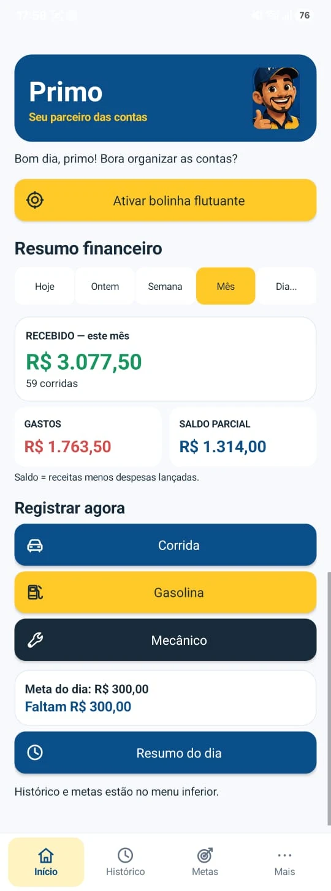
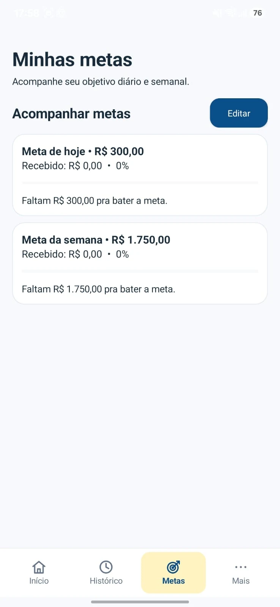
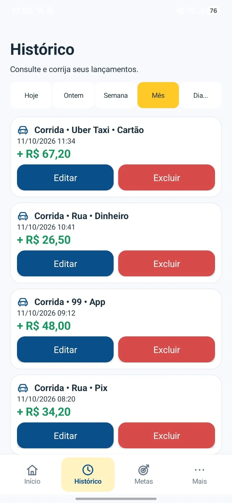
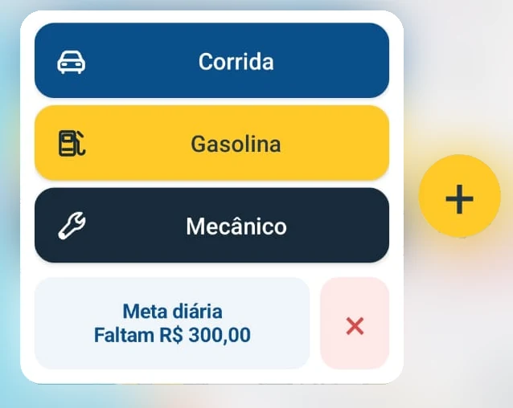
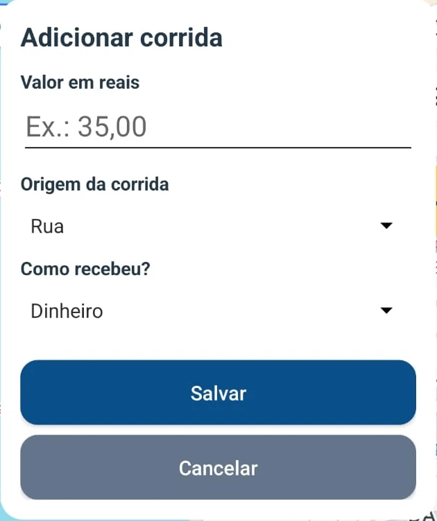
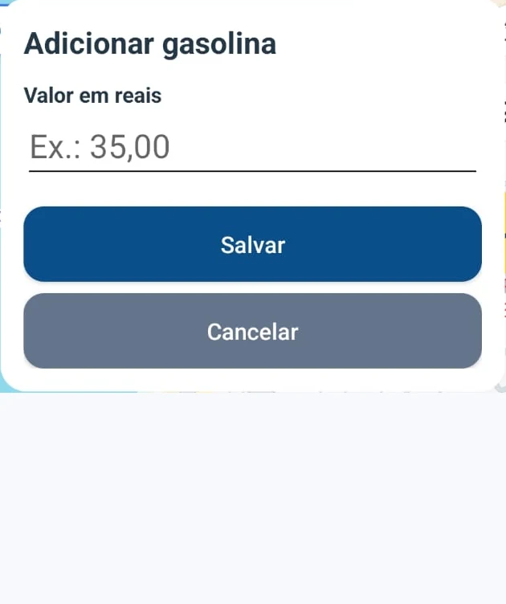
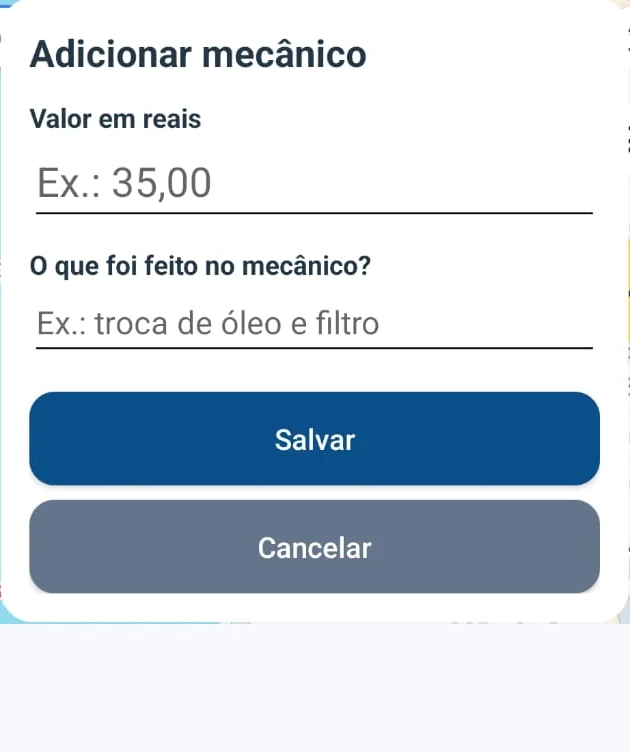
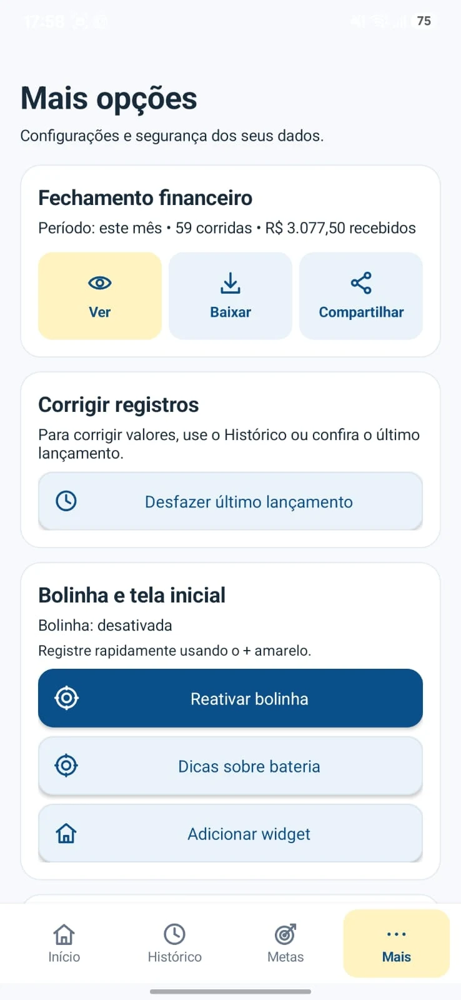

<p align="center">
  
</p>

<h1 align="center">Primo</h1>
<p align="center"><strong>Seu parceiro das contas</strong></p>
<p align="center">Um jeito simples de registrar corridas, acompanhar ganhos e controlar gastos, sem complicação.</p>

<p align="center">
  
  
  
  
</p>

<p align="center">
  <a href="#conheça-o-primo">Conheça o app</a> ·
  <a href="#registre-sem-sair-do-aplicativo-que-está-usando">Bolinha flutuante</a> ·
  <a href="#instalação">Instalação</a> ·
  <a href="docs/GUIA_TECNICO.md">Documentação técnica</a>
</p>

## As contas do trabalho, em um só lugar

Entre uma corrida e outra, é fácil perder a conta do que entrou, do que foi gasto no carro e de quanto falta para a meta. O Primo reúne essas informações em uma interface direta, com botões grandes e atalhos para o registro do dia a dia.

Desenvolvido inicialmente para o uso pessoal de um motorista, o aplicativo atende taxistas e quem trabalha com corridas de rua, 99 ou Uber Taxi. Funciona **offline, sem conta e sem login**, com os dados armazenados no próprio aparelho.

## Conheça o Primo

<p align="center">
  
  
  
</p>
<p align="center"><strong>Início</strong> — veja o resultado do período · <strong>Metas</strong> — acompanhe o objetivo · <strong>Histórico</strong> — consulte e corrija</p>

Consulte **Hoje, Ontem, Semana, Mês ou outro dia**. Veja os valores recebidos, as despesas registradas, o saldo parcial e a quantidade de corridas.

> O saldo parcial é a receita de corridas menos as despesas lançadas. Ele não representa necessariamente o lucro líquido do motorista. Os valores das capturas são ilustrativos e não comprovam rendimentos reais.

## Registre sem sair do aplicativo que está usando

A **bolinha flutuante** deixa os atalhos do Primo disponíveis sobre outros aplicativos Android, mediante permissão de sobreposição. Toque no `+` amarelo, escolha o tipo de lançamento e registre o valor sem abrir a tela principal.

<p align="center">
  
</p>
<p align="center"><em>Captura real sobre o Google Maps, recortada e com o mapa desfocado para preservar a privacidade.</em></p>

- **Três atalhos:** Corrida, Gasolina e Mecânico.
- **Posição ajustável:** arraste a bolinha e acomode-a perto de uma borda.
- **Meta à vista:** confira quanto falta para a meta ativa, com prioridade para a diária.
- **Controle simples:** feche pelo `X` e reative pelo app ou pelo widget na tela inicial.
- **Confirmação de registro:** o formulário e a bolinha sinalizam em verde após salvar com sucesso.

A bolinha depende das permissões e das restrições de bateria do Android; alguns aparelhos podem encerrar o serviço. O Primo oferece dicas e reativação manual. Faça os registros com o veículo parado.

## Poucas informações, registros organizados

<p align="center">
  
  
  
</p>
<p align="center"><strong>Corrida</strong> — valor, origem e recebimento · <strong>Gasolina</strong> — valor do abastecimento · <strong>Mecânico</strong> — valor e descrição opcional</p>

Nas corridas, selecione **Rua, 99 ou Uber Taxi** e a forma de recebimento: **Dinheiro, Pix, Cartão ou App**. As origens são informadas manualmente: o Primo não possui integração automática com essas plataformas.

Registre o abastecimento e as despesas de oficina quando necessário. Os lançamentos ficam no histórico e entram no fechamento do período.

## Controle para o dia a dia

| Recurso | Como ajuda |
| --- | --- |
| **Resumo financeiro** | Reúne receitas, despesas, saldo parcial e quantidade de corridas por período. O Resumo do dia consulta os dados sem apagar os registros. |
| **Metas diária e semanal** | Objetivos independentes e opcionais, com progresso e valor restante. O cálculo considera apenas as receitas de corridas. |
| **Histórico e correções** | Consulte períodos anteriores, edite lançamentos ou exclua com confirmação. Em Mais, confira o último lançamento para corrigir ou desfazer. |
| **Fechamento em CSV** | Veja receitas por origem e pagamento, gastos com gasolina e mecânico e média por corrida. Baixe ou compartilhe o CSV com ganhos e gastos separados e período no nome do arquivo. |
| **Backup JSON** | Exporte registros e metas para guardar uma cópia fora do aparelho. A importação substitui os registros atuais e pede confirmação antes da seleção do arquivo. |
| **Tutoriais com o Primo** | O mascote guia o uso com destaque visual dos controles. Há um guia do app e uma simulação da bolinha, disponíveis novamente em Mais. Os guias não salvam lançamentos. |

<p align="center">
  
</p>
<p align="center"><em>Na aba Mais, fechamento, correções e atalhos ficam agrupados por assunto.</em></p>

### Seus dados ficam no aparelho

O Primo utiliza SQLite local, sem servidor, anúncios ou rastreadores. Não exige internet nem lê dados privados de outros aplicativos. Os arquivos de CSV e backup são exportados por ação do usuário; guarde as cópias em um local seguro.

**Antes de importar um backup, exporte os dados atuais.** A restauração substitui os lançamentos existentes. Para atualizar o aplicativo, instale por cima da versão anterior, sem desinstalar.

## Instalação

O Primo é instalado por **APK** em aparelhos com **Android 8.0 ou superior**. Atualmente, a distribuição é feita pelo GitHub Actions; não há GitHub Release publicada com o APK.

1. Abra [Actions → Gerar APK Android assinado](https://github.com/Daniel-SLima/Primo-Android/actions/workflows/android-apk.yml).
2. Escolha uma execução bem-sucedida da versão desejada e abra os **Artifacts** do job `build`.
3. Baixe **Primo-APK-Release** e extraia o ZIP para obter `app-release.apk`. O download de artefatos pelo GitHub exige uma sessão autenticada.
4. Transfira o APK para o aparelho, abra-o e permita a instalação dessa origem se o Android solicitar.
5. Se já utiliza o Primo, faça um backup e **instale por cima**, preservando os registros e as metas.

Os artefatos têm **retenção de 14 dias**. Se o arquivo expirou, o responsável pelo repositório pode executar o workflow novamente com os secrets de assinatura configurados. O processo exige a chave permanente e verifica o certificado do APK.

Consulte o [guia de entrega e verificação no aparelho](docs/ENTREGA_PRIMO_1.0.0.md) para conferir a instalação e o primeiro uso.

## Primeiros passos

1. Instale o Primo e abra o aplicativo.
2. Conheça o tutorial interativo; também é possível acessá-lo em **Mais → Aprenda com o Primo**.
3. Em **Metas → Editar**, configure uma meta diária ou semanal, se desejar.
4. Registre uma **Corrida**, selecionando a origem e como recebeu.
5. Anote **Gasolina** e **Mecânico** quando houver uma despesa.
6. Consulte o resumo no **Início** e confira ou corrija lançamentos no **Histórico**.
7. Exporte periodicamente um JSON em **Mais → Segurança dos dados → Exportar backup**.

Para usar o atalho sobre outros apps, conceda a permissão de sobreposição e ative a bolinha pelo Início. A aba Mais também permite solicitar a adição do widget, conforme o suporte do launcher.

## Tecnologias e arquitetura

| Tecnologia | Uso no projeto |
| --- | --- |
| **Kotlin e Android nativo** | Activity, Views e layouts programáticos, componentes do sistema, formulários e tutoriais. |
| **SQLite** | Persistência local via `SQLiteOpenHelper`, com valores monetários em centavos inteiros. |
| **SharedPreferences** | Metas, preferências e estado dos tutoriais. |
| **Android SDK** | `minSdk 26`, `targetSdk 35` e `compileSdk 36`; serviço em primeiro plano, sobreposição e widget. |
| **Gradle e Java 17** | Gradle 9.3.1 e Android Gradle Plugin 9.1.1, com compilação Kotlin integrada ao plugin Android. |
| **GitHub Actions e JUnit 4** | Testes unitários de fechamento/CSV e etapas dos tutoriais; geração e verificação do APK release assinado. |

O projeto tem um módulo `app`. A `MainActivity` organiza Início, Histórico, Metas e Mais; `Ui` reúne os componentes visuais e o formulário compartilhado. `EntriesDb` cuida dos registros, `GoalsStore` das metas e `ClosingReport` dos cálculos e do CSV. A bolinha é implementada em `FloatingService`; widget, compartilhamento e tutoriais têm componentes próprios.

Com Java 17, Gradle 9.3.1 e Android SDK configurados, execute na raiz:

```sh
gradle :app:testDebugUnitTest
gradle :app:assembleDebug
```

Os testes automatizados não substituem a validação das permissões, da sobreposição e do visual em um aparelho Android. Mais detalhes de build, assinatura e compatibilidade estão no [guia técnico](docs/GUIA_TECNICO.md).

## Projeto e desenvolvimento

O Primo é um projeto independente de desenvolvimento Android, criado inicialmente para ajudar um motorista a organizar as contas do trabalho. A versão **1.0.0** consolida o escopo validado da 0.9.1, mantendo a identidade azul e amarela, o mascote e os fluxos existentes.

A documentação de evolução e os cuidados de atualização continuam disponíveis:

- [Guia técnico e manutenção](docs/GUIA_TECNICO.md).
- [Histórico completo e documentação do README anterior](docs/HISTORICO_README.md).
- [Tutorial guiado do mascote](docs/TUTORIAL_PRIMO_0.9.0.md).
- [Checklist de acabamento e regressão visual](docs/ACABAMENTO_PRIMO_0.9.1.md).
- [Entrega da versão 1.0.0](docs/ENTREGA_PRIMO_1.0.0.md).

## Licença e contribuição

O repositório ainda não possui um arquivo `LICENSE`; uma licença de uso e distribuição não foi definida. A disponibilidade pública do código não concede, por si só, uma licença de código aberto.

Sugestões e relatos de problemas podem ser enviados pelas [issues do projeto](https://github.com/Daniel-SLima/Primo-Android/issues). Ao relatar um problema, informe o modelo do aparelho, a versão do Android e os passos para reproduzir, sem incluir dados pessoais, backups reais ou credenciais.
